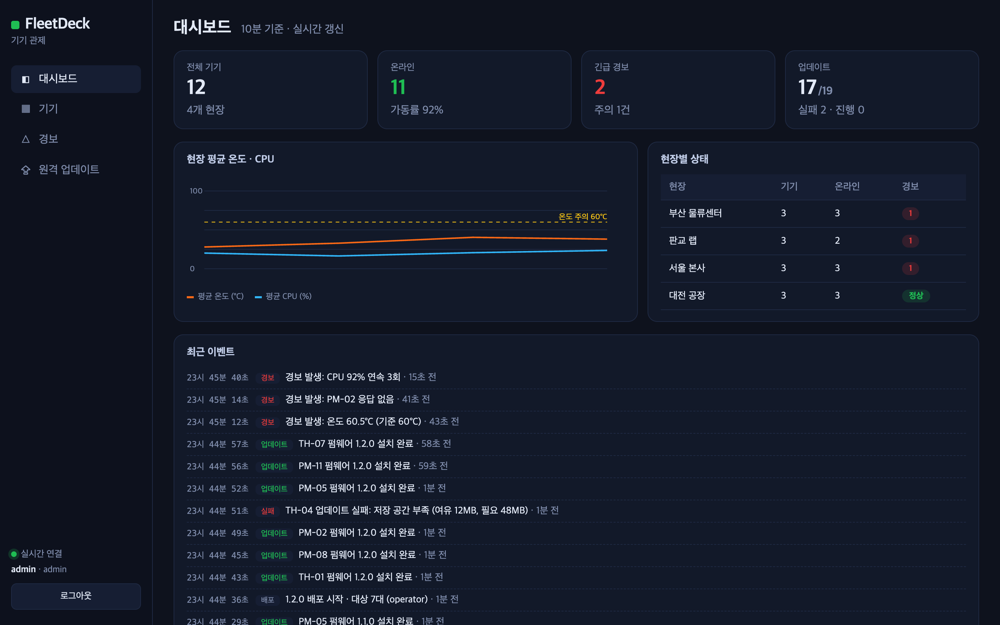
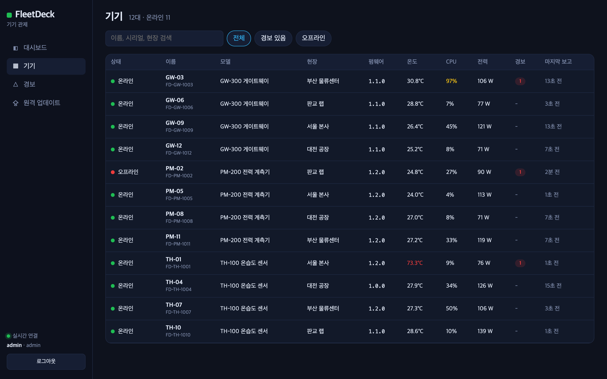
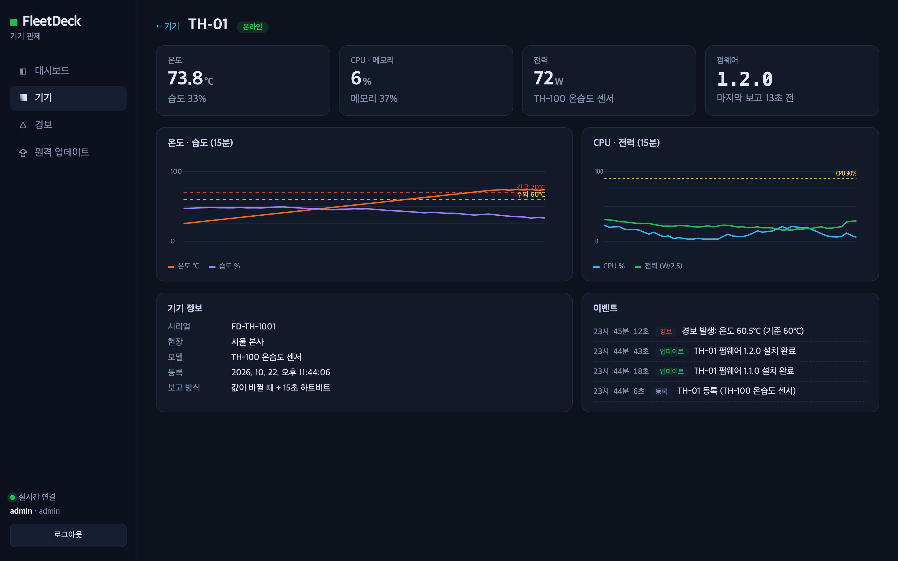
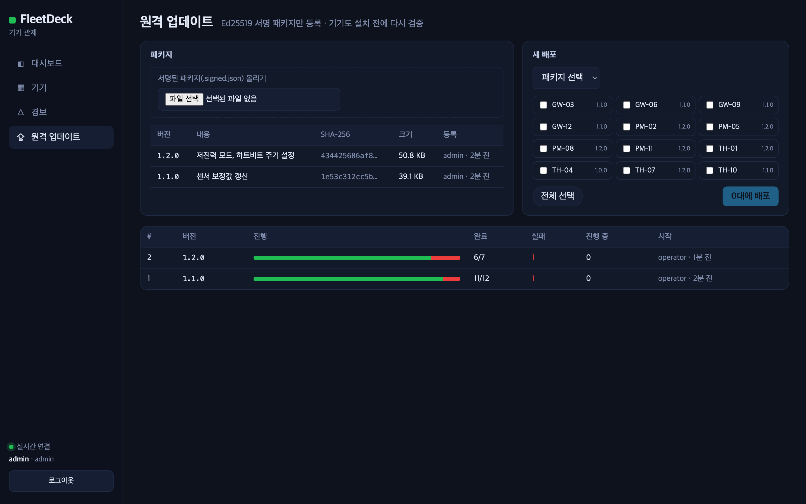

# FleetDeck

IoT 기기 관제와 **서명 기반 원격 업데이트(OTA)** 를 한 번에 보여 주는 작은 템플릿입니다.
가상 기기 12대가 상태를 보고하고, 관리 웹에서 경보를 확인하고, 서명된 펌웨어를 골라 배포합니다.

- 서버: Node.js(TypeScript) · `node:http` · `node:sqlite` — 외부 런타임 의존성 0
- 관리 웹: React 19 · TypeScript · 의존성 없는 SVG 차트 · 서버 푸시(SSE) 실시간 갱신
- 기기 시뮬레이터: 등록 · 상태 보고 · 업데이트 서명 검증 · 설치 결과 보고
- 서명: Ed25519 (개인키는 배포 PC 에만, 서버와 기기는 공개키만)

| 대시보드 | 기기 목록 |
|---|---|
|  |  |
| **기기 상세** | **원격 업데이트** |
|  |  |

## 실행

Node.js 22.6 이상(TypeScript 를 그대로 실행하고 `node:sqlite` 를 씁니다).

```bash
npm run keygen                 # keys/release.key.pem (개인키) · keys/release.pub.pem (공개키)
npm run web:install && npm run web:build
npm run server                 # http://localhost:8787  (admin / operator / viewer, 비밀번호 demo)
npm run sim                    # 가상 기기 12대
```

펌웨어 서명 · 등록:

```bash
node tools/sign.ts fw.bin 1.1.0 --notes "센서 보정값 갱신" --upload http://localhost:8787
```

그다음 관리 웹 「원격 업데이트」에서 패키지와 기기를 골라 배포합니다.

## 설계에서 신경 쓴 것

| 주제 | 방식 |
|---|---|
| 서버 부하 | 기기는 값이 의미 있게 바뀌었을 때 + 15초 하트비트로만 보고합니다. 업데이트는 **상태 보고 응답에 얹어** 전달하므로 기기가 업데이트 확인용으로 따로 폴링하지 않습니다. |
| 업데이트 보안 | 서명 대상은 `버전 + 내용 SHA-256` 입니다. 다른 버전에 같은 서명을 재사용하거나 내용을 바꾸면 서버가 등록을 거절하고(보안 이벤트 기록), 기기도 설치 전에 다시 검증합니다. 같은 버전 덮어쓰기는 금지합니다. |
| 경보 | 같은 기기 · 같은 규칙은 한 건으로 묶고, 값이 정상으로 돌아오면 자동 해제합니다. 온도(주의 60°C · 긴급 70°C), CPU 90% 연속 3회, 30초 무응답. 규칙은 순수 함수라 단위 테스트합니다. |
| 권한 | admin(패키지 등록) · operator(배포 · 경보 확인) · viewer(조회). |
| 기기 인증 | 페어링 코드로 등록하면 기기별 토큰을 받고, 이후 모든 기기 요청은 토큰을 상수 시간 비교로 검증합니다. |

시뮬레이터에는 일부러 문제가 생기는 기기를 넣었습니다: 과열(TH-01), 간헐적 끊김(PM-02), CPU 과부하(GW-03), 저장 공간 부족으로 업데이트 실패(TH-04).

## 테스트

```bash
npm test     # 경보 규칙 · 서명(버전 재사용 · 변조 · 다른 키) · 등록→보고→경보→서명 배포 끝단 · 권한
```

## 구조

```text
server/src/   app.ts(API) · db.ts(스키마) · alerts.ts(경보 규칙) · signing.ts(Ed25519) · index.ts
server/test/  node:test 테스트
agent/src/    sim.ts — 가상 기기
tools/        keygen.ts · sign.ts
web/          React 관리 웹 (build.mjs — esbuild, 네이티브가 안 되는 환경은 esbuild-wasm)
```

## 다음 단계(로드맵)

- iOS(SwiftUI) · Android(Compose) 관리 앱과 푸시 알림
- 단계적 배포(카나리 → 전체)와 자동 중단 기준
- 실제 기기 에이전트(Rust 또는 Python) · MQTT 전송 옵션
- PostgreSQL 어댑터

## 라이선스

MIT — [LICENSE](LICENSE)
